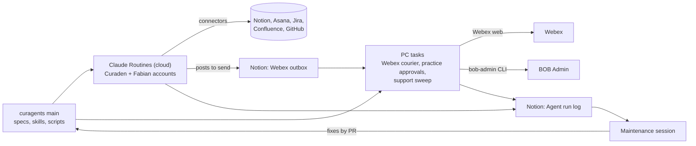

# Curadenapps Agents

Claude agents and skills that run the day-to-day around Curaden's apps: **BOB** (the
clinician app and BOB Admin) first, the **Curaprox app** next. They keep Notion,
Asana, Jira, Confluence, GitHub and Webex in step, answer app support requests, approve
practice sign-ups, keep the roadmap honest and draft the team's updates.

Every agent is a markdown spec in this repo. Claude reads the spec from `main` at the
start of each run, so a merged PR is live on the next run. No servers to deploy.

> Snapshot of 27 Nov 2026. **Who runs what right now** lives in the Notion
> **Agent registry**, not here: [`RUNTIME.md`](RUNTIME.md) explains it.

---

## How it works



| Layer | Lives in | Owned by |
|-------|----------|----------|
| **What** an agent does | This repo (`agents/`, `skills/`, `scripts/`, `tools/`) | The maintenance session; every change is a PR |
| **When** it runs | Claude Routines in the cloud for connector-only work; Claude desktop scheduled tasks on a PC for anything that needs a browser or a sign-in | Set up once per account ([`docs/curaden-routines.md`](docs/curaden-routines.md)) |
| **Who** runs it | The Notion **Agent registry**: one row per run, with the account (`Curaden`, `Personal`, `Fabian`, `Paused`) | Sean flips one field |
| **Did it work** | The Notion **Agent run log**: every run writes one row, even on failure | Checked every weekday at 10:15; fixes go in by PR |

Why the split: Webex has no connector we may use, and IT blocks browser automation on
the Curaden account. So the cloud does all the thinking, writes Webex posts to the
**Webex outbox** in Notion, and one PC task (the **Webex courier**) posts them through
Webex web on Sean's own sign-in. No bot tokens.

---

## What runs when

Times are Zurich, weekdays unless noted. The Agent registry is the live list.

| Run | When | Where | What it does |
|-----|------|-------|--------------|
| Orchestrator daily | 07:45 | Cloud (Fabian) | Board moves by fixed rules; the rest go on "Orchestrator: board moves to decide" |
| Truth Catcher scan | 07:58, 13:58 | Cloud (Curaden) | Asana BOB App and the App Tasks intake board vs the Notion Product Roadmap |
| Webex courier + Webex Sweep | 08:02, 09:02, 12:02, 17:02 | PC (Sean, Personal) | Posts the Webex outbox, then logs new Webex messages and meetings in the Inbox and Asana |
| Boom Boom Derek | 08:20 (posted 09:02) | Cloud (Curaden) + courier | What Phinamic owes, checked against the roadmap; a ping in the common chat |
| Practice approvals | 08:50, 12:50, 16:50 | PC (Fabian and Sean) | `bob-admin practices auto-approve` on prod; exceptions and duplicate sign-ups to Asana |
| App Support | Hourly, Mon–Thu | Cloud (Fabian) | Writes the answer to every "App Requests & Feedback" submission |
| App Support (cover) | Hourly, Fri | Cloud (Curaden) | Same, on Sean's cover day |
| App Support invites | 09:10, 13:10, 16:10, Mon–Thu | PC (Fabian) | Adds requesters once their reply is approved |
| bob-support sweep | Hourly 07:30–19:30, Mon–Thu | PC (Fabian) | Read-only Admin Console facts on every open support request |
| Agent run log check | 10:15 | Cloud (Curaden) | Missed or failed runs → fix by PR or one Inbox row for Sean |
| Roadmap watch | Mon 07:40 | Cloud (Curaden) + courier | Drift report: Notion roadmap vs Asana and Jira; summary to App Team |
| Roadmap pack | Mon 08:40 | Cloud (Curaden) + courier | Weekly roadmap picture and PDF; the post waits for Sean's OK |
| Roadmap ← Jira sync | Thu 07:30 | Cloud (Curaden) | The only automation that writes roadmap rows from Jira |
| Team update draft | Thu 14:00 | Cloud (Curaden) + courier | Notion draft; posted to Webex after Sean ticks Approved |
| Feedback QA report | Fri 10:10 | Cloud (Curaden) + courier | PDF report from the feedback inbox to the Webex QA space |
| Figma diff | 07:00 UTC | GitHub Actions | `figma-diff.yml`, gated on the file's last change |

Everything else runs on request, by trigger phrase, in any Claude Code session on this
folder.

---

## Agents

Each spec in [`agents/`](agents/) has the same frontmatter (trigger, memory,
idempotency key, dry run, output schema, `model:`) and a fenced domain. The same agents
are registered as Claude Code subagents in [`.claude/agents/`](.claude/agents/) for
parallel work ([`agents/orchestrator.md`](agents/orchestrator.md) §3a).

### Orchestration and governance

| Agent | What it does | Started by |
|-------|--------------|------------|
| [Orchestrator](agents/orchestrator.md) | Routes requests to the right agent, answers "agent status" and "inbox check-up", files escalations in the Inbox, does the daily board moves | Daily 07:45, "board moves", any request |
| [Truth Catcher](agents/truth-catcher.md) | Asana vs the Notion Product Roadmap (not on roadmap, too early, status drift); watches the support intake board for untriaged or stuck requests. Comments in Sean's voice | Twice a day, "truth catcher" |
| [Boom Boom Derek](agents/boom-boom-derek.md) | Truth Catcher for the Phinamic dev team: a ledger of what they owe across Webex, Jira, Confluence, the WBS and Asana; funny-but-clear pings | Daily 08:20, "boom boom" |
| [Brand Asset](agents/brand-asset.md) | RACI approval gates, taxonomy, audit trail for brand assets | Asana section change, manual |
| [Asana Maintenance](agents/asana-maintenance.md) | Kanban routing, update snippets, audit trail writes | Called by other agents, manual |

### Support and operations

| Agent | What it does | Started by |
|-------|--------------|------------|
| [App Support](agents/app-support.md) | Answers every app support form submission from the FAQs, board history, Jira and Notion; the owner checks each reply; bugs and gaps go to Jira. Learns into [`docs/app-support-faq.md`](docs/app-support-faq.md). Setup for Fabian: [`docs/app-support-quickstart.md`](docs/app-support-quickstart.md) | Hourly, "app support" |
| [Webex Sweep](agents/webex-sweep.md) | Reads the watched Webex spaces and new meetings; one Inbox row per item, triage tasks in BOB App › Webex inbox, update comments on Asana tasks | Inside the Webex courier, "check webex" |
| [Meeting Notes](agents/meeting-notes.md) | A Webex meeting (summary, action items, transcript, recording frames) into a Notion recap. Calls without a Webex recap come from [Yogurt](docs/yogurt.md), the local recorder | "meeting notes" |
| [Feedback QA](agents/feedback-qa.md) | Notion feedback inbox → checks against scope and recent changes → PDF report to the Webex QA space; Confluence for full UATs | Fri 10:10, "send QA report" |
| [Announcements](agents/announcements.md) | Weekly, two-week or monthly team update from every tool; Notion draft, Webex after approval | Thu 14:00, "team update", "post it" |

### Roadmap and release

| Agent | What it does | Started by |
|-------|--------------|------------|
| [Roadmap Watch](agents/roadmap-watch.md) | Weekly drift report: Notion roadmap vs Asana and Jira. Read-only except its report | Mon 07:40, "roadmap watch" |
| [Roadmap Pack](agents/roadmap-pack.md) | One picture and a PDF of the BOB roadmap for the App Team (build in [`tools/roadmap-pack`](tools/roadmap-pack/)) | Mon 08:40, "roadmap pack" |
| [Release](agents/release.md) | Release notes, Notion changelog, GitHub tag for BOB and RevolveNote | Manual only: "cut release" |

### Markets and growth

| Agent | What it does | Started by |
|-------|--------------|------------|
| [Market Rollout](agents/market-rollout.md) | Rollout partner for BOB, then the Curaprox app: UAE (Apr 2027) and Switzerland, the main market (May 2027), then Slovenia, South Africa, USA, Japan; Italy parked. Onboarding, super users, training modules, partner prep. Drafts only | "rollout status", "onboard … for …" |
| [Growth](agents/growth.md) | BOB user acquisition since marketing stopped supporting it (25 Nov 2026): plans per market, content calendar, partner kits, experiments, funnel G1–G4. Drafts only | "growth plan …", "content calendar" |

### Data and integrations

| Agent | What it does | Started by |
|-------|--------------|------------|
| [Notion Sync](agents/notion-sync.md) | Owns `.truth-cache/`: requirements, roadmap, brand guidelines from Notion | Before Truth Catcher, "sync notion" |
| [Figma](agents/figma.md) | BOB library monitor, export checks, design diffs | GitHub Actions, "check figma" |
| [Webflow](agents/webflow.md) | Publishing gate: brand and clinical-claim checks, asset sync | Brand Asset approval, manual |
| [GitHub](agents/github.md) | Links Curadenapps PRs and commits to Jira and Asana; read-only on GitHub | "github status", PR events |

### Model tiers

Each spec's `model:` field is the single source; workflows, `package.json` and the
subagent wrappers follow it.

| Tier | Agents | Why |
|------|--------|-----|
| Haiku 4.5 | notion-sync, figma, github, asana-maintenance | Mechanical: poll, diff, link, route |
| Sonnet 5.5 | orchestrator, truth-catcher, boom-boom-derek, webex-sweep, app-support, meeting-notes, feedback-qa, announcements, roadmap-watch, roadmap-pack, market-rollout, growth, webflow | Judgement on structured data |
| Opus 5.5 | brand-asset, release | Approval gates, clinical claims, releases |

---

## Skills

Skills load by trigger phrase in any Claude session on this folder. Phrases are in
each `SKILL.md`.

| Skill | What it covers |
|-------|----------------|
| [`webex-web`](skills/webex-web/SKILL.md) | The only way to work in Webex: post (with @mentions and files), read spaces, read meetings. Webex web on Sean's sign-in; no bot tokens |
| [`bob-admin`](skills/bob-admin/SKILL.md) | BOB Admin through the `bob-admin` CLI: reports, users and Super Users, roles, practice approvals, products, news, partner API tokens, and every API endpoint through `call`. PC only, own sign-in |
| [`bob-support`](skills/bob-support/SKILL.md) | App Support requests against the Admin Console: `inbox`, `check <task>`, `do <task>` (rename, address, delete, temporary password, email) on the owner's yes |
| [`bob-qa`](skills/bob-qa/SKILL.md) | QA of the BOB web app: `qa run smoke`, `qa run coach-loop`, pass / fail report. Writes on test only |
| [`feedback-qa`](skills/feedback-qa/SKILL.md) | Feedback triage and the QA report |
| [`uat`](skills/uat/SKILL.md) | Full UAT for a new build or a large feature: Asana tasks, Confluence UAT page, UAT log |
| [`market-rollout`](skills/market-rollout/SKILL.md) | Rollout status, onboarding, super users, training modules, partner prep and follow-ups |
| [`growth`](skills/growth/SKILL.md) | Acquisition plans, posts in Sean's voice, partner kits, event packs, website and store checks, experiments |
| [`curaden-communications`](skills/curaden-communications/SKILL.md) | RevolveNote → GitHub sync, Jira → Notion BOB sync. The BOB weekly moved to the Announcements agent |

---

## Tools

| Tool | What it is |
|------|------------|
| [`tools/bob-admin`](tools/bob-admin/) | `bob-admin`, `bob-support` and `bob-qa`: Python CLIs ([CLI-Anything](https://github.com/HKUDS/CLI-Anything) format) built from the BOB platform's OpenAPI spec. `--json` on every command, test and prod, prod writes locked by default. Install with `tools/bob-admin/install.ps1` |
| [`tools/roadmap-pack`](tools/roadmap-pack/) | The weekly roadmap picture and PDF build (Python standard library + headless Chromium) |
| [`scripts/`](scripts/) | `webex-post.js`, `webex-read.js`, `webex-meetings.js` (Webex web), `sync-checkout.sh` (SessionStart hook), `gate.ts` (cheap change checks before a run), `truth-scan.ts`, `qa-report.mjs`, `render-pdf.ps1`, Yogurt setup |

---

## Repository map

```
README.md          ← You are here
CLAUDE.md          ← Claude Code instructions (loaded automatically)
dream.md           ← Shared context every agent reads first (§2–3)
RUNTIME.md         ← Where and when each agent runs, the switch, run-log rules, monitoring
SCOPE.md           ← Hard boundaries: what the system may and may not do
│
├── agents/        ← Agent specs (single source of truth, incl. model tier)
├── .claude/       ← Subagent wrappers → agents/*.md; settings with the SessionStart hook
├── skills/        ← Invokable skills (SKILL.md + references/)
├── tools/         ← bob-admin / bob-support / bob-qa CLIs, roadmap-pack build
├── scripts/       ← Webex web scripts, checkout sync, change gates, PDF rendering
├── docs/          ← handoff.md (open work), App Support FAQ / playbook / voices,
│                    Curaden Routine prompts, migration runbook, Yogurt
├── templates/     ← Curaprox-styled HTML for the team update PDF
├── src/           ← TypeScript API helpers (Notion, Asana, Figma, Webflow) for the GitHub Actions
├── .github/       ← GitHub Actions: figma-diff (scheduled), sync-and-scan (manual)
├── pc-tasks/      ← Archived copies of the old PC scheduled tasks (Oct 2026)
├── games/         ← Prototypes: Plaque Hunter (brushing game), BRISTLE
├── .planning/     ← Early GSD planning docs (Mar–Oct 2026), kept for history
└── .truth-cache/  ← Written only by notion-sync; never edit by hand
```

---

## Rules every run follows

From [`RUNTIME.md`](RUNTIME.md) and [`SCOPE.md`](SCOPE.md):

- **Notion is the source of truth.** Asana is where work moves; the agents anchor it to
  Notion. On timing, the Phinamic WBS beats the roadmap.
- **Check the switch first.** A scheduled run reads its Agent registry row and stops if
  it isn't its account's turn.
- **Latest specs, never edited by a run.** Each run fetches `origin/main`. Fixes go
  through a PR from the maintenance session.
- **One run-log row per run**, even on failure. A run with no row counts as missed.
- **Never type credentials.** A sign-in prompt is a failed run.
- **Read Notion in view mode only.** SQL and rows mode share a small hourly allowance
  across the workspace.
- **People decide.** Sends, approvals, access grants and prod writes need a yes,
  except a standing yes written into a spec (automatic practice approval).
  Clinical or medical claims go through the Legal gate.
- **Keep requester data anonymised.** This repo is public.

---

## Getting started

**Working on the specs (Claude Code).** Clone the repo and open it in Claude Code. The
SessionStart hook keeps the checkout on an up-to-date `main`. Read [`CLAUDE.md`](CLAUDE.md),
then [`dream.md`](dream.md), then pick up open work in [`docs/handoff.md`](docs/handoff.md).

```bash
git clone https://github.com/Curadenapps/curagents.git
cd curagents
```

**Setting up a scheduled run.** Use the paste-once prompt in [`RUNTIME.md`](RUNTIME.md)
("Scheduled task prompts") or the Routine prompts in
[`docs/curaden-routines.md`](docs/curaden-routines.md), then add or flip its row in the
Agent registry.

**Fabian's side** (App Support, practice approvals, the orchestrator):
[`docs/app-support-quickstart.md`](docs/app-support-quickstart.md).

**The BOB CLIs** (PC only): run `tools/bob-admin/install.ps1`, then sign in with your
own BOB Admin account. See [`tools/bob-admin/README.md`](tools/bob-admin/README.md).

**GitHub Actions and the TypeScript helpers** need a `.env`
(`cp .env.example .env`, then `npm install`). The cloud Routines don't: they use
Claude's connectors.

| Variable | Used by |
|----------|---------|
| `ANTHROPIC_API_KEY` | GitHub Actions runs |
| `NOTION_API_KEY`, `NOTION_ROOT_DATABASE_ID` | notion-sync; run-log rows from the bob-support sweep and practice approvals |
| `ASANA_ACCESS_TOKEN`, `ASANA_PROJECT_GID`, `ASANA_WEBHOOK_SECRET` | `truth-scan.ts`, `gate.ts`, the Asana webhook handler |
| `FIGMA_API_TOKEN`, `FIGMA_FILE_KEY`, `FIGMA_TEAM_ID` | figma |
| `WEBFLOW_API_TOKEN`, `WEBFLOW_SITE_ID`, `WEBFLOW_*_COLLECTION_ID` | webflow |
| `FIREFLIES_API_KEY` | meeting-notes fallback (Webex summaries come first) |
| `CHROME_PATH` | PDF rendering (optional, auto-detects Chrome or Edge) |
| `DRY_RUN` | `true` by default for the TypeScript helpers; the agents themselves run live |

---

## Known gaps

| Gap | Effect |
|-----|--------|
| IT blocks browser automation on the Curaden account | All Webex work runs on Sean's PC (the courier). PC off or Webex signed out: posts wait in the outbox; Boom Boom pings expire at 18:00 |
| Webex web allows one live tab per browser | With Sean's own Webex tab open, ours is online ~15–20 s per load; `webex-post.js` posts in one call and retries safely with a marker |
| No Notion Business plan | Notion SQL and rows-mode reads share a small hourly allowance, so agents read in view mode only; no Notion AI meeting notes |
| Support mailboxes (info@ / support@bobscore.com) | Waiting for IT to approve a mail connector; App Support works from the Asana form only |
| Asana webhook not registered | brand-asset and asana-maintenance don't fire on Asana events; they run when called |
| Figma file key and Webflow site ID not set | figma and webflow stay in a config-error state until they are |
| Run log has no `orchestrator` or `practice-approvals` agent option | Those runs log as `other` |

Open work and decisions waiting on Sean: [`docs/handoff.md`](docs/handoff.md).
